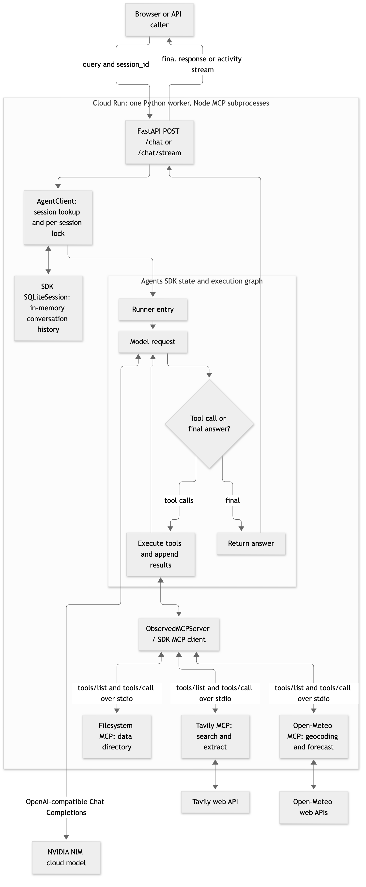
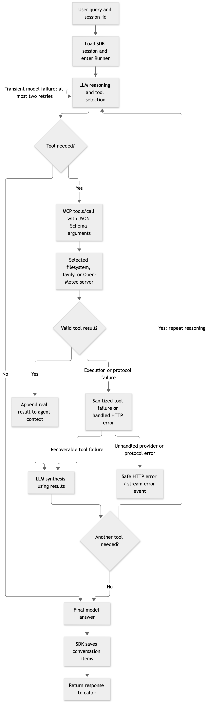
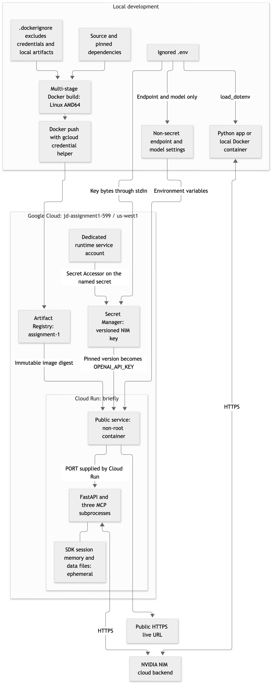

# Briefly

A briefing workspace built with FastAPI and the OpenAI Agents SDK. NVIDIA NIM
provides model inference; filesystem, Tavily, and Open-Meteo MCP servers provide
file access, web research, and weather data.

**Live application:** [csci599-a1-2ez6etscva-uw.a.run.app](https://csci599-a1-2ez6etscva-uw.a.run.app)

## Setup

Requirements: Python 3.13, Node.js 22 or newer, and an NVIDIA NIM API key.

```bash
python3 -m venv .venv
.venv/bin/python -m pip install -r requirements.txt
npm ci
cp .env.example .env
```

Configure the local `.env` with a key from [NVIDIA Build](https://build.nvidia.com):

```dotenv
OPENAI_API_KEY=your-nvidia-api-key-here
OPENAI_BASE_URL=https://integrate.api.nvidia.com/v1
OPENAI_MODEL=nvidia/nemotron-3-ultra-550b-a55b
```

The `OPENAI_*` names configure the OpenAI-compatible NVIDIA endpoint. The
example selects the deployed Ultra model; the client also defaults to
`nvidia/nemotron-3-ultra-550b-a55b` when `OPENAI_MODEL` is unset. An API key is
required at startup. Ultra is the default because live comparison checks found
Lightning skipped tools for file, weather, and search requests; Ultra completed
those checks with actual MCP calls. See the [model verification](docs/verification/model-tool-comparison.md).
Existing shell variables take precedence over `.env`.
Credentials and local dependency directories are excluded from Git and Docker.

Optional configuration:

| Variable | Purpose | Default |
| --- | --- | --- |
| `TAVILY_API_KEY` | Authenticated Tavily search/extraction | Capped keyless access |
| `MCP_SERVERS_CONFIG` | Alternative MCP manifest path | `mcp_servers.json` |
| `PORT` | HTTP listening port | `8080` |

## Run

```bash
.venv/bin/python main.py
```

The service binds to `0.0.0.0:$PORT`. The local interface is available at
http://localhost:8080/ and API documentation at http://localhost:8080/docs.

The chat accepts direct questions and briefing requests. Three example buttons
prefill an editable prompt for political news, AI developments, or Los Angeles
weather; selecting one does not send a request. Briefings use a compact report
layout with summary, developments, implications, and source sections. Weather
reports use conditions, rain/wind, and travel sections. The Sources action jumps
to the source section. A collapsed project overview explains the implementation
and links to the API documentation.

Follow-up questions share the current session. **New workspace** or a page reload
starts a fresh session. **Copy** and **Download** export the latest response as
text; **Save to workspace** requests a file write through the agent. Connection
indicators show MCP health. Live green tags beneath the input show running and
completed research steps, with distinct error/retry states and an expandable
timestamped activity log. Health
checks establish transport connectivity, not external API quota or availability.

Example queries:

- `Give me a briefing on this week's AI policy developments in Europe.`
- `What is the weather in Los Angeles, California? Include units and local time.`
- `Read notes.txt and summarize it.`
- `Search for the official MCP specification and save a short summary to mcp-summary.txt.`

## HTTP API

| Endpoint | Behavior |
| --- | --- |
| `GET /` | Briefing interface |
| `POST /chat` | JSON request and final JSON response |
| `POST /chat/stream` | Newline-delimited JSON activity and final response/error events |
| `GET /mcp/status` | MCP connectivity and exposed tool counts |

```bash
curl http://localhost:8080/chat \
  -H 'Content-Type: application/json' \
  -d '{"query":"Remember that my favorite color is blue.","session_id":"demo"}'

curl http://localhost:8080/chat \
  -H 'Content-Type: application/json' \
  -d '{"query":"What is my favorite color?","session_id":"demo"}'
```

Request: `{"query":"...","session_id":"..."}`. Response: `{"response":"..."}`.
Both request fields must be nonempty strings; `session_id` is limited to 128
characters. Invalid requests return 422, model timeouts 504, connection failures
and rate limits 503, and other handled model/protocol failures 502.

Streaming responses emit operational events followed by a `response` or `error`
event. HTTP status is already 200 once streaming starts; callers must handle
error events. Heartbeats keep idle streams active, and disconnecting cancels
the pending request. Events omit tool arguments/results, credentials, and private
model reasoning. Transient model server errors, timeouts, and connection failures
receive at most two retries of the individual model call.

## MCP integrations

The SDK performs real `tools/list` discovery and `tools/call` invocation over
stdio. Servers start during application startup and close during shutdown.
Tool schemas are cached; model decisions determine tool selection and chaining.
A failed startup connection is logged and omitted while healthy servers remain
available. Tool errors are reported to the model or mapped to handled API errors.

| Server | Version | Purpose and scope |
| --- | --- | --- |
| [Filesystem](https://github.com/modelcontextprotocol/servers/tree/main/src/filesystem) | `@modelcontextprotocol/server-filesystem@1.0.0` | Read/write files under `data/`; application code and credentials are outside the allowed root |
| [Tavily](https://github.com/tavily-ai/tavily-mcp) | `tavily-mcp@0.2.22` | Web research through `tavily_search` and `tavily_extract` |
| [Open-Meteo](https://github.com/cmer81/open-meteo-mcp) | `open-meteo-mcp-server@2.5.2` | Structured location and forecast data through `geocoding` and `weather_forecast`, without an additional key |

Dependencies are pinned in `package.json` and `package-lock.json`. The manifest
is `mcp_servers.json`; relative manifest/server paths resolve from the project
root. Filesystem media reads are disabled for the text-only model integration.
The sample file is `data/notes.txt`; generated files remain under `data/`.

Each subprocess receives only its configured credentials plus the MCP client's
standard process environment. Tavily runs from `data/` to keep its dotenv loader
away from application credentials. Its MCP SDK dependency is overridden to
`1.31.0` for [GHSA-6qxp-vccf-f47h](https://github.com/advisories/GHSA-6qxp-vccf-f47h).

## Sessions and runtime

`AgentClient` reuses one asynchronous API client and agent per process. SDK
`SQLiteSession` objects store conversation history in memory, keyed by
`session_id`. Per-session locks serialize turns while separate sessions can run
concurrently. The session registry stores SDK objects, not custom chat history.
SDK tracing is disabled.

Session history and workspace files are instance-local and can disappear on
restart, scale-to-zero, or deployment. The deployed service uses one worker,
session affinity, and at most one instance per revision. These settings support
warm-instance follow-ups but do not provide durable storage. Failed MCP
subprocesses are not automatically restarted.

## Docker

The multi-stage image installs pinned Python and Node dependencies separately,
then copies runtime artifacts into a Debian-based Python 3.13 / Node 22 image.
It runs as UID/GID `10001:10001`; application files are read-only to that user and
`/app/data` is writable. The build context excludes credentials, local dependency
trees, generated briefings, tests, and documentation. Startup requires no package
installation.

```bash
docker build --platform linux/amd64 -t assignment-1:local .

docker run --rm --name assignment-1-local --platform linux/amd64 \
  --env-file .env -p 127.0.0.1:8081:8080 -e PORT=8080 assignment-1:local
```

The container interface is available at http://localhost:8081/. The image includes
only the sample notes file; generated files are lost when the container is removed.

## Deployment

The deployed service is `csci599-a1` in project `jd-assignment1-599`, region
`us-west1`. Its image is stored in the regional `assignment-1` Artifact Registry
repository. Deployment requires Docker, an authenticated gcloud CLI, a billed
Google Cloud project, and permission to manage the service and its resources.

```bash
./deploy.sh PROJECT_ID GOOGLE_ACCOUNT_EMAIL us-west1
```

The wrapper prepares resources, builds and pushes a Linux AMD64 image, then
deploys the recorded plan. The individual preparation and deployment commands are:

```bash
.venv/bin/python scripts/prepare_cloud_run.py \
  --project PROJECT_ID --account GOOGLE_ACCOUNT_EMAIL --region us-west1
.venv/bin/python scripts/deploy_cloud_run.py --project PROJECT_ID
```

Preparation enables the required APIs, creates the repository and runtime service
account if absent, and uploads local keys to Secret Manager through stdin. Each
run creates new secret versions and an image tag. The deployment pins the image
digest and numeric secret versions. Non-secret endpoint/model settings use
`--env-vars-file`; runtime keys use `--set-secrets`. The dedicated service account
has Secret Accessor on the named secrets, not project-wide access.

| Runtime setting | Value |
| --- | --- |
| Public access | Enabled |
| CPU / memory | 1 vCPU / 512 MiB |
| Minimum / maximum revision instances | 0 / 1 |
| Request concurrency | 8 |
| Request timeout | 600 seconds |
| Execution environment | Generation 2 |
| CPU allocation | Request-based |
| Session affinity | Enabled |

Deployment plans, image references, readiness, runtime settings, and access-policy
records are stored in `docs/deployment/`.

## Costs

The configuration uses NVIDIA NIM rather than paid OpenAI inference. NVIDIA
account limits apply; Tavily keyless access is capped. Cloud Run compute/network
usage, Artifact Registry storage, and Secret Manager usage may incur charges.
Zero minimum instances permits scale-to-zero; an instance limit is not a spending
cap. See [cost disclosure](docs/costs.md) for component costs, published rates,
estimate assumptions, and account-specific limits.

## Verification

```bash
.venv/bin/python -m unittest discover -s tests -v
node tests/test_frontend.cjs
.venv/bin/python -m pip check
```

The 23 Python tests exercise HTTP contracts, SDK memory, concurrency, retries,
real MCP discovery/invocation, directory boundaries, and failure handling with
mocked model HTTP. Node tests cover stream parsing, safe rendering, weather
sections, session behavior, and exports using a minimal DOM. Both suites passed
inside the non-root Linux container. The Node harness does not cover browser
layout; separate Chrome desktop/mobile checks and an actual deployed browser
request are recorded in the [frontend verification report](docs/verification/frontend-single-chat.md).

Live deployed checks separately verified model responses, all three MCPs,
memory recall/isolation, weather lookup, search/extraction/save/read-back, and
missing-file recovery. An isolated local fault server verified malformed-protocol
recovery without exposing fault-injection tools publicly. Evidence and limits:

- [Final submission review](docs/verification/submission-review.md)
- [Current deployment](docs/verification/assignment-exact-url.md)
- [Deployed behavior](docs/verification/cloud-final-checks.md)
- [API deployment checks](docs/verification/cloud-smoke-checks.md)
- [Container verification](docs/verification/docker-checks.md)
- [Transport and malformed-response coverage](docs/verification/fault-checks.md)

Repeat live backend checks with `.venv/bin/python scripts/verify_cloud_run.py`. The script
uses the recorded deployment URL unless `--url` is supplied, makes real model/tool
requests, writes a uniquely named verification summary in the remote workspace,
and saves evidence to ignored `tmp/cloud-checks.json`. Pass `--output PATH` to
choose another location. Recorded verification evidence is preserved by default.
Generated facts and citations remain subject to source review.

## Architecture

### System architecture



[SVG](docs/diagrams/system-architecture.svg) · [Mermaid source](docs/diagrams/system-architecture.mmd)

### Tool invocation loop



[SVG](docs/diagrams/tool-invocation-loop.svg) · [Mermaid source](docs/diagrams/tool-invocation-loop.mmd)

### Deployment and environment flow



[SVG](docs/diagrams/deployment-topology.svg) · [Mermaid source](docs/diagrams/deployment-topology.mmd)

The Chat Completions adapter connects the SDK to NVIDIA's compatible endpoint.
Each MCP server runs as a Node subprocess inside the application container.
Local development loads `.env`; deployment exposes pinned Secret Manager
versions as environment variables without including key values in the image.

## References

- [OpenAI Agents SDK models and providers](https://developers.openai.com/api/docs/guides/agents/models)
- [OpenAI Agents SDK running agents and sessions](https://developers.openai.com/api/docs/guides/agents/running-agents)
- [OpenAI Agents SDK MCP integration](https://developers.openai.com/api/docs/guides/agents/integrations-observability)
- [FastAPI lifespan](https://fastapi.tiangolo.com/advanced/events/)
- [Docker multi-stage builds](https://docs.docker.com/build/building/multi-stage/)
- [Cloud Run secrets](https://docs.cloud.google.com/run/docs/configuring/services/secrets)
